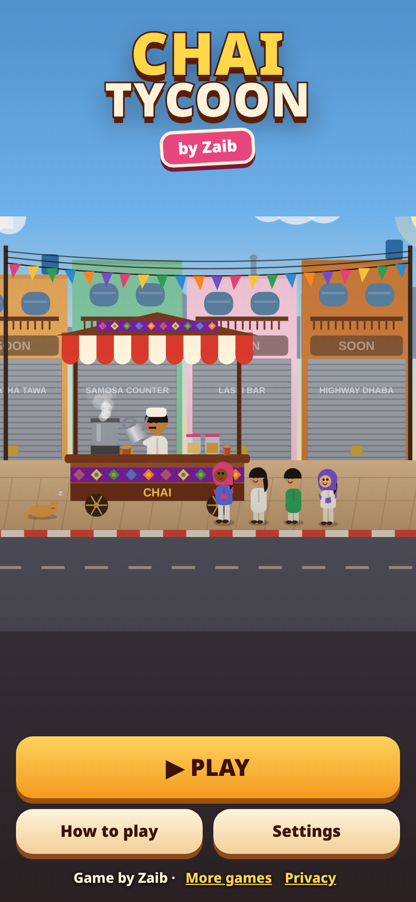
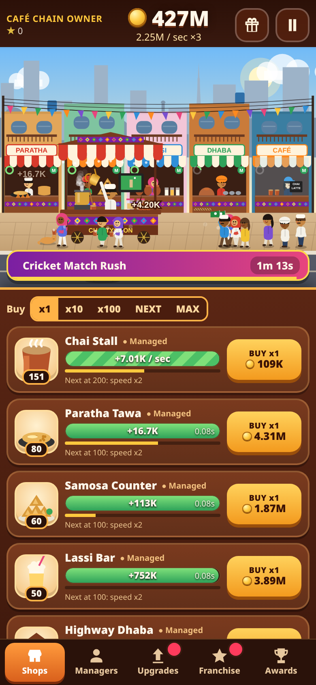

# Chai Tycoon ☕

**An idle chai-empire tycoon for mobile browsers. Game by Zaib.**

▶ **Play:** https://zaibgames.com/chai-tycoon/

You start with one roadside chai stall. Tap the street to pour chai for the customers lining up, buy more stalls and hire managers to run them, then expand into paratha and samosa counters, a lassi bar, a highway dhaba, cafés in a dozen cities, a delivery fleet and finally a chai export company.

## Features
- **8 shops** with their own speed, profit and cost curves: Chai Stall, Paratha Tawa, Samosa Counter, Lassi Bar, Highway Dhaba, City Cafés, Delivery Fleet and Chai Export Co.
- **Tap to serve:** each tap pays you and restarts any shop that's waiting.
- **Managers** for each shop keep it running by itself, even offline.
- **Milestones:** owning 25/50/100/200/300/400 of a shop doubles its speed, and later counts multiply profit. **Empire milestones** (every shop at 10, 25, 50…) give all profits x2.
- **106 upgrades** with flavourful names (Elaichi Chai, Lachha Layers, Charpai Lounge…) that multiply profit, and tap upgrades that add a share of your income to each tap.
- **Offline earnings** with a welcome-back summary. Managed shops keep earning while you're away, capped at 2h to start and up to 12h with perks.
- **Franchise (prestige):** reset for Stars. Each unspent Star gives +2% profit, or you can spend Stars on 7 permanent perks (Family Recipe, Long Naps, Head Start, Loyal Staff, Festival Planner, Golden Hands, Star Shine).
- **Timed events:** Cricket Match Rush (TV on the stall, crowds, all profits x3, taps x5), Eid Special (night lanterns, Samosa & Lassi x7), Monsoon Pakora Time (rain and umbrellas, Chai x10) and the Wedding Order tap challenge.
- **Golden kulhads** float by now and then: catch one for coins or a x7 Golden Rush.
- **Daily reward streak** over 7 days, ending in a permanent Golden Kettle (+10%).
- **54 achievements** (+1% profit each), stats and rank titles from Roadside Chaiwala up to Cosmic Chaiwala.
- **Big-number formatting:** K, M, B, T, then aa, ab … zz (scientific notation is available in settings).
- **Animated street-food scene:** customers in kurtas, topis, dupattas and turbans walk up and leave sipping steaming kulhads. The chaiwala does the long pour, there's truck-art painting, bunting, rickshaws, delivery bikes, an export truck, a sleeping cat and a day/night cycle, and shops open up along the bazaar as you buy them.
- **Synthesized music and sound:** tabla keherwa, sitar-like plucks and a dhol for events, all made in WebAudio and run through a master limiter.
- **Pacing tuned with a balance simulator:** 6 shops in the first 5 minutes, the first Franchise in about 40–60 minutes, and progress that keeps going for days.
- **Tech:** one self-contained HTML file (Canvas + DOM, no libraries). Works in portrait and landscape and respects safe areas. Runs at 60 fps using delta time, lowers graphics quality automatically if needed, pauses when the tab is hidden and saves progress in localStorage.

## Controls
| Action | Touch / mouse | Keyboard |
|---|---|---|
| Serve chai / catch golden kulhad | Tap the street scene | Space / Enter |
| Buy shops | BUY button (amount x1 / x10 / x100 / NEXT / MAX) | 1–8, X cycles the amount |
| Hire manager | Managers tab | Shift + 1–8 |
| Start an idle shop | Tap its icon or bar | – |
| Switch tabs | Bottom tabs (left side in landscape) | Tab |
| Pause | II button | P / Esc |

## Credits
Game, art, music and code by **Zaib**. All names, art and sounds are original.
